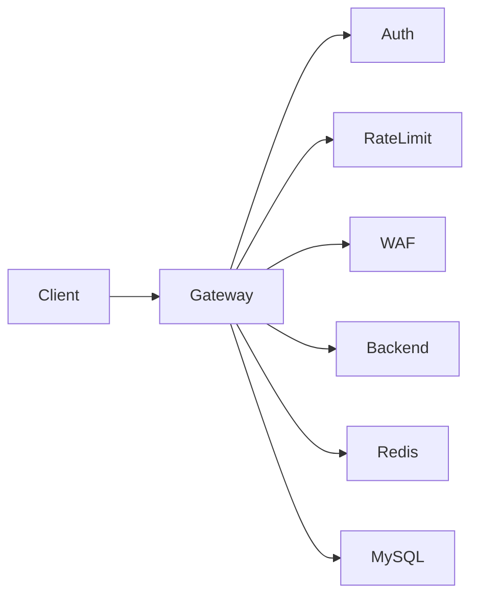

# Documentation Checklist

**Every repo: 5 core docs + ADRs. Written for operators, not just yourself.**

---

## Required Files

| File | Audience | Min Length | Template |
|------|----------|------------|----------|
| `README.md` | Recruiter, new dev | 300 lines | `examples/README.template.md` |
| `ARCHITECTURE.md` | Tech lead, architect | 200 lines | `examples/ARCHITECTURE.template.md` |
| `docs/CONFIGURATION.md` | Operator, DevOps | 150 lines | `examples/CONFIGURATION.template.md` |
| `docs/OPERATIONS.md` | On-call, SRE | 200 lines | `examples/OPERATIONS.template.md` |
| `docs/ADR/*.md` | Future maintainers | 1 per decision | `examples/ADR-template.md` |

---

## `README.md` — Required Sections

```markdown
# Project Name

One-paragraph: what it does, who it's for, why it exists.

## Architecture

Mermaid diagram + 3-sentence explanation.

## Quick Start

```bash
cp .env.example .env
docker compose up -d --wait
curl http://localhost:8081/health
```

## Live Demo

[https://project.yourname.dev](https://project.yourname.dev) (custom domain, HTTPS)

## Testing

```bash
mvn clean verify          # unit + contract + integration
docker compose up -d --wait
./scripts/smoke-test.sh   # 11 assertions
k6 run load-tests/baseline-test.js
```

## Load Results

See [load-tests/RESULTS.md](load-tests/RESULTS.md) — real numbers, raw JSON committed.

## Configuration

See [docs/CONFIGURATION.md](docs/CONFIGURATION.md) — every env var.

## Operations

See [docs/OPERATIONS.md](docs/OPERATIONS.md) — health, failures, rotations.

## Gaps (Honest)

- No HA / k8s manifests
- No pen test
- No Testcontainers in CI (local Docker only)
- ...

## License

Proprietary / Apache-2.0 / MIT — see [LICENSE](LICENSE).
```

---

## `ARCHITECTURE.md` — Required Sections

```markdown
# Architecture

## Component Diagram



## Components

| Component | Tech | Responsibility | Scaling |
|-----------|------|----------------|---------|
| Gateway | Spring Boot 3 | Auth, rate limit, WAF, proxy | Horizontal |
| Auth | Spring Auth | OAuth2/JWT validation | Stateless |
| RateLimit | Redis + Lua | Sliding window per tenant+IP | Redis Cluster |
| Backend | Spring Boot 3 | Business logic | Horizontal |
| MySQL | 8.0 | Audit, metadata | Primary/Replica |
| Redis | 7 | Cache, rate limit, idempotency | Sentinel/Cluster |

## Data Flow

1. Request → Gateway → Auth (JWT validation)
2. Auth → Tenant/Client extraction
3. RateLimit → Sliding window check
4. WAF → Payload inspection
5. Proxy → Backend → Response
6. Audit → MySQL (async)
7. Metrics → Prometheus

## Trust Boundaries

| Boundary | Protection |
|----------|------------|
| Internet → Gateway | TLS termination, WAF, rate limit |
| Gateway → Backend | mTLS, header allowlist |
| Gateway → DB | Private subnet, IAM auth |
| Gateway → Redis | Private subnet, ACL |

## Failure Modes

| Component Fails | Behavior |
|-----------------|----------|
| Auth (IdP down) | Cached JWK → 200; unknown kid → 503 |
| Redis down | Fail-closed (rate limit 0, idempotency fail) |
| MySQL down | Readiness fails, no traffic routed |
| Backend down | 502/503, circuit breaker |

## Scaling Limits

| Metric | Current | Target |
|--------|---------|--------|
| Max throughput | 200 req/s | 1000 req/s |
| p99 latency | 45 ms | < 100 ms |
| Concurrent connections | 5,000 | 50,000 |
```

---

## `docs/CONFIGURATION.md` — Every Env Var

```markdown
# Configuration Reference

## Required (No Defaults)

| Variable | Description | Example |
|----------|-------------|---------|
| `MYSQL_ROOT_PASSWORD` | Root DB password | `changeme` |
| `MYSQL_PASSWORD` | App DB password | `changeme` |
| `INTERNAL_OPS_API_KEY` | 32-char hex for /compliance, /feedback | `openssl rand -hex 32` |
| `OAUTH2_ISSUER_URI` | IdP issuer | `https://auth.example.com` |
| `OAUTH2_JWK_SET_URI` | JWKS endpoint | `https://auth.example.com/.well-known/jwks.json` |
| `OAUTH2_AUDIENCE` | Expected JWT `aud` | `my-api` |
| `OAUTH2_REQUIRED_SCOPES` | Comma-separated | `api.read,api.write` |

## Optional (With Defaults)

| Variable | Default | Description |
|----------|---------|-------------|
| `SPRING_PROFILES_ACTIVE` | `prod` | `dev` disables auth |
| `SERVER_PORT` | `8081` | Gateway port |
| `MYSQL_HOST` | `mysql` | DB host |
| `MYSQL_PORT` | `3306` | DB port |
| `MYSQL_DB` | `appdb` | DB name |
| `MYSQL_USER` | `appuser` | DB user |
| `REDIS_HOST` | `redis` | Redis host |
| `REDIS_PORT` | `6379` | Redis port |
| `REDIS_PASSWORD` | `` | Empty = no auth |
| `RATE_LIMIT_TIER_HIGH` | `50` | Req/s for HIGH trust |
| `RATE_LIMIT_TIER_MEDIUM` | `30` | Req/s for MEDIUM |
| `RATE_LIMIT_TIER_LOW` | `10` | Req/s for LOW |
| `IDEMPOTENCY_TTL` | `24h` | Replay window |
| `COMPLIANCE_DEFAULT_WINDOW` | `24h` | Evidence lookback |
| `COMPLIANCE_MAX_WINDOW` | `90d` | Max evidence window |
| `COMPLIANCE_DEFAULT_ROWS` | `1000` | CSV default rows |
| `COMPLIANCE_MAX_ROWS` | `10000` | CSV max rows |
| `CORS_ALLOWED_ORIGINS` | `https://app.example.com` | Browser origins |
| `TRUST_PROXY` | `false` | Trust X-Forwarded-For |
```

---

## `docs/OPERATIONS.md` — Runbooks

```markdown
# Operations Guide

## Health Semantics

| Endpoint | Meaning | SLA |
|----------|---------|-----|
| `/health` | Process alive | 99.99% |
| `/actuator/health/liveness` | Container healthy | 99.99% |
| `/actuator/health/readiness` | Ready for traffic | 99.9% |

## Failure Matrix

| Symptom | Likely Cause | Action |
|---------|--------------|--------|
| Readiness 503 | MySQL/Redis down | Check deps, restart |
| 401 on all | IdP down, JWKS stale | Check IdP, wait for cache refresh |
| 429 spike | Legitimate load or attack | Check logs, adjust tier |
| 502/503 from backend | Backend down | Check backend logs, restart |
| p99 latency > 500ms | GC pressure, DB slow | Check metrics, scale |

## Rotation Procedures

### IdP Signing Key

1. Publish new JWKS **before** IdP signs with it
2. Gateway caches; unknown `kid` triggers refresh
3. Monitor `gateway.auth.dependency.failure` metric
4. After 2x TTL, old key can be revoked

### Operator Key

```bash
NEW_KEY=$(openssl rand -hex 32)
# Update secret in Vault/GitHub Env
# Rolling restart gateway pods
```

### DB Password

1. Generate new password
2. Update MySQL user
3. Update secret
4. Rolling restart gateway + backend

## Compliance Export

```bash
FROM=$(date -u -d '24 hours ago' +%Y-%m-%dT%H:%M:%SZ)
TO=$(date -u +%Y-%m-%dT%H:%M:%SZ)
curl -fsS "https://api.example.com/compliance/evidence/summary?from=$FROM&to=$TO" \
  -H "X-Internal-Ops-Key: $KEY" | jq .
```

## Backup & Restore

| Data | Frequency | Retention | Restore Test |
|------|-----------|-----------|--------------|
| MySQL | Daily + WAL | 30 days | Monthly |
| Redis | RDB + AOF | 7 days | Monthly |
| MinIO | Versioned | 90 days | Quarterly |

## Capacity Alerts

| Metric | Warning | Critical |
|--------|---------|----------|
| CPU > 70% | 5 min | 2 min |
| Memory > 80% | 5 min | 2 min |
| Disk > 75% | 1 hr | 15 min |
| DB connections > 80% | 5 min | 2 min |
| Redis memory > 85% | 5 min | 2 min |
```

---

## `docs/ADR/0001-example.md` — Architecture Decision Record

```markdown
# ADR 0001: Use Redis for Rate Limiting & Idempotency

## Status
Accepted

## Context
Need distributed, atomic rate limiting and idempotency across gateway replicas.

## Decision
Use Redis with Lua scripts for atomic operations.

## Consequences

### Positive
- Sub-millisecond latency
- Atomic compare-and-set for idempotency
- Horizontal scaling via Redis Cluster

### Negative
- Additional infrastructure
- Single point of failure (mitigated by Sentinel/Cluster)
- Lua script debugging complexity

## Alternatives Considered
- In-memory (not distributed)
- Database (too slow, contention)
- Consul (overkill)

## Links
- [RateLimiter.java](../src/main/java/.../RateLimiter.java)
- [IdempotencyService.java](../src/main/java/.../IdempotencyService.java)
```