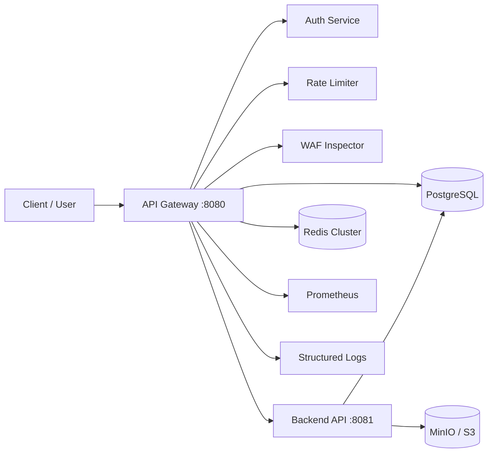

# Architecture

## Component Diagram



## Components

| Component | Technology | Responsibility | Scaling Strategy |
|-----------|------------|----------------|------------------|
| **API Gateway** | Spring Boot 3 / Java 21 | TLS termination, OAuth2 validation, rate limiting, WAF, request routing, proxy | Horizontal (stateless) |
| **Auth Service** | Spring Authorization Server / Keycloak | OAuth2/OIDC, JWT issuance, JWKS | Horizontal (stateless) |
| **Rate Limiter** | Redis + Lua | Sliding window per tenant+IP, tiered limits | Redis Cluster |
| **WAF Inspector** | Custom + Regex | SQLi, XSS, Path Traversal, Command Injection detection | Horizontal (stateless) |
| **Backend API** | Spring Boot 3 / Java 21 | Business logic, file metadata, user management | Horizontal (stateless) |
| **Upload Worker** | Spring Batch / Go | Chunk assembly, virus scan, thumbnail, checksum | Horizontal (queue-based) |
| **Orchestrator** | Temporal / Custom Saga | Multi-step workflows with compensation | Horizontal (sharded) |
| **PostgreSQL** | 16 | Audit logs, metadata, users, workflows | Primary + Replica |
| **Redis** | 7 Cluster | Rate limit, idempotency, cache, sessions | Cluster (3+ masters) |
| **MinIO** | RELEASE.2024 | Object storage, versioning, lifecycle | Distributed (4+ nodes) |
| **Prometheus** | 2.45 | Metrics collection, alerting | HA pair |
| **Grafana** | 10.2 | Dashboards, alerting | Single (config in Git) |

## Data Flow

### Request Path (Authenticated)

1. **Client** → HTTPS → **Gateway** (TLS termination)
2. **Gateway** → **Auth Service** → Validate JWT (local JWKS cache)
3. **Auth** → Returns `tenant_id`, `client_id`, `scopes` → **Gateway** binds to request
4. **Gateway** → **Rate Limiter** → Redis sliding window check (per tenant+IP+tier)
5. **Gateway** → **WAF** → Payload inspection (SQLi, XSS, Path Traversal, CMDi)
6. **Gateway** → **Idempotency** → Redis `SET NX EX` + Lua CAS (for unsafe methods)
7. **Gateway** → **Backend** → Proxied request (header allowlist, body size limit)
8. **Backend** → **PostgreSQL** / **MinIO** → Business logic
9. **Backend** → **Gateway** → Response
10. **Gateway** → **Audit Log** → PostgreSQL (async, non-blocking)
11. **Gateway** → **Metrics** → Prometheus (counters, histograms)
12. **Gateway** → **Client** → Response

### Upload Flow (Async)

1. **Client** → `POST /uploads/initiate` → **Gateway** → **Metadata API** → Returns `uploadId` + presigned URLs
2. **Client** → Direct `PUT` to **MinIO** (presigned, 15-min TTL, single-use)
3. **Client** → `POST /uploads/{id}/complete` → **Gateway** → **Orchestrator** → `ProcessUpload` saga
4. **Orchestrator** → **Upload Worker** → Assemble parts → **Virus Scan** → **Thumbnails** → **Checksum** → **Index Metadata** → **Notify**
10. **Worker** → **Metadata API** → `status = READY` → **Notification Service** → Webhook/Email/Push

## Trust Boundaries

| Boundary | Protection |
|----------|------------|
| Internet → Gateway | TLS 1.3, WAF, Rate Limit, Header Allowlist |
| Gateway → Auth | mTLS, JWKS cache, short TTL |
| Gateway → Backend | mTLS, Header Allowlist, Body Size Limit |
| Gateway → Redis | Private Subnet, ACL, TLS |
| Gateway → PostgreSQL | Private Subnet, IAM Auth, TLS |
| Backend → MinIO | Presigned URLs (15-min, single-use) |
| Worker → MinIO | IAM Role, Private Endpoint |
| All → Prometheus | Internal Network, Basic Auth |

## Failure Modes

| Component Fails | Behavior | Recovery |
|-----------------|----------|----------|
| **Auth (IdP Down)** | Cached JWKS → 200 for known keys; unknown `kid` → 503 `auth_dependency_unavailable` | Auto-recovers when IdP returns; max 2x JWKS TTL |
| **Redis Down** | Rate limit → fail-closed (0 req/s); Idempotency → fail-closed (reject new, serve cached) | Redis Sentinel failover < 30s; circuit breaker |
| **PostgreSQL Down** | Readiness → 503; no traffic routed | Primary-Replica failover < 60s; connection pool retry |
| **MinIO Down** | Presigned URLs fail; uploads → 503 | MinIO distributed (4+ nodes); auto-heal |
| **Backend Down** | Gateway → 502/503; circuit breaker opens | Health check → auto-restart; scale HPA |
| **Orchestrator Down** | In-flight sagas persist in DB; resume on restart | Temporal/Custom: durable execution log |

## Scaling Limits (Current → Target)

| Metric | Current | Target (v2) |
|--------|---------|-------------|
| Max Throughput | 200 req/s | 1,000 req/s |
| p99 Latency | 45 ms | < 100 ms |
| Concurrent Connections | 5,000 | 50,000 |
| Upload Throughput | 50 MB/s | 500 MB/s |
| Saga Throughput | 100/min | 1,000/min |
| Redis Ops/sec | 50k | 500k |

## Security Controls

| Control | Implementation |
|---------|----------------|
| **Auth** | OAuth2 Client Credentials + JWT (RS256), JWKS cache, audience + scope validation |
| **Rate Limit** | Redis sorted-set sliding window, per tenant+IP, 4 tiers (50/30/10/0) |
| **WAF** | Regex-based: SQLi, XSS, Path Traversal, Command Injection; 403 on match |
| **Idempotency** | Redis `SET NX EX` + Lua compare-and-set/delete; owner-tokened claims |
| **Presigned URLs** | 15-min TTL, single-use, MinIO SSE-S3 encryption at rest |
| **Virus Scan** | ClamAV on every upload; quarantine on hit; async, non-blocking |
| **Audit** | Every request → PostgreSQL (async); `client_id`, `tenant_id`, `decision`, `attack_type` |
| **Headers** | CSP, HSTS, X-Frame-Options, Referrer-Policy, Permissions-Policy |
| **Secrets** | Vault / GitHub Environments; zero in repo; rotation documented |

## Observability

| Signal | Tool | Key Metrics |
|--------|------|-------------|
| **Logs** | Structured JSON (Logstash encoder) | `request_id`, `tenant_id`, `client_id`, `decision`, `latency_ms` |
| **Metrics** | Micrometer → Prometheus | `gateway_requests_total`, `gateway_request_duration_seconds`, `gateway_waf_blocked_total`, `gateway_rate_limited_total`, `gateway_idempotency_replay_total` |
| **Traces** | OpenTelemetry → Jaeger | W3C `traceparent`, span per filter + backend call |
| **Health** | Spring Boot Actuator | `/health` (liveness), `/actuator/health/readiness` (deps) |
| **Alerts** | PrometheusRule → Alertmanager → PagerDuty/Slack | `rate(gateway_requests_total{status=~"5.."}[5m]) > 0.01`, `gateway_redis_down == 1` |

## Deployment Topology

```
┌─────────────────────────────────────────────────────────────┐
│                      Fly.io / AWS VPC                       │
│  ┌──────────────┐  ┌──────────────┐  ┌──────────────────┐  │
│  │   Gateway    │  │   Gateway    │  │    Gateway       │  │
│  │  (3 replicas)│  │  (3 replicas)│  │  (3 replicas)    │  │
│  └──────┬───────┘  └──────┬───────┘  └────────┬─────────┘  │
│         │                 │                   │             │
│  ┌──────┴─────────────────┴───────────────────┴──────────┐  │
│  │                    Redis Cluster (3M/3R)                │  │
│  └────────────────────────────────────────────────────────┘  │
│         │                                    │               │
│  ┌──────┴──────────────┐            ┌───────┴────────────┐  │
│  │  PostgreSQL Primary │            │  MinIO (4 nodes)   │  │
│  │  + 2 Replicas       │            │  Distributed       │  │
│  └─────────────────────┘            └────────────────────┘  │
└─────────────────────────────────────────────────────────────┘
```

---

## Key Design Decisions (See ADRs)

| ADR | Decision |
|-----|----------|
| [0001](docs/ADR/0001-redis-rate-limiting.md) | Redis sorted-set for exact sliding-window rate limiting |
| [0002](docs/ADR/0002-lua-idempotency.md) | Lua CAS for atomic idempotency |
| [0003](docs/ADR/0003-temporal-vs-custom.md) | Custom saga orchestrator over Temporal |
| [0004](docs/ADR/0004-minio-presigned.md) | Presigned URLs for direct-to-MinIO uploads |
| [0005](docs/ADR/0005-oauth2-local-validation.md) | Local JWT validation over introspection |