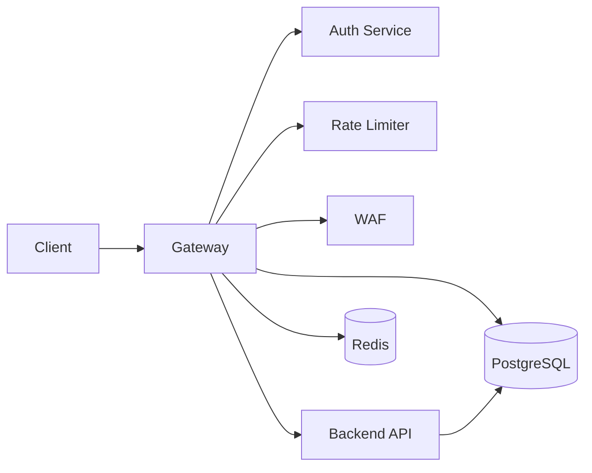

# [Project Name]

> One-paragraph: what it does, who it's for, why it exists. **No marketing fluff.**

---

## Architecture



**3-sentence explanation:** The gateway terminates TLS, validates OAuth2 JWTs, enforces per-tenant rate limits via Redis sliding windows, inspects payloads for injection attacks, and proxies to a stateless backend. Redis provides atomic idempotency and rate-limiting state. PostgreSQL stores durable audit logs and metadata.

---

## Quick Start

```bash
# 1. Clone and configure
git clone https://github.com/yourname/project.git
cd project
cp .env.example .env
# Edit .env with your secrets (see docs/CONFIGURATION.md)

# 2. Start the stack
docker compose up -d --wait

# 3. Verify
curl http://localhost:8080/health
curl http://localhost:8080/actuator/health/readiness

# 4. Run tests
mvn clean verify          # Unit + Contract + Integration
docker compose up -d --wait
./scripts/smoke-test.sh   # 11 assertions
k6 run load-tests/baseline-test.js
```

---

## Live Demo

**[https://project.yourname.dev](https://project.yourname.dev)** — Custom domain, HTTPS, deployed on Fly.io

---

## Testing

| Layer | Command | Target |
|-------|---------|--------|
| Unit | `mvn test` | ≥ 80% coverage |
| Contract | `mvn verify -Dpact.verify=true` | All pacts pass |
| Integration | `mvn verify -DskipUnitTests` | Testcontainers PG/Redis |
| Smoke | `./scripts/smoke-test.sh` | 11 assertions |
| Load | `k6 run load-tests/baseline-test.js` | p95 < 200ms, 0% errors |

**Load Results:** See [load-tests/RESULTS.md](load-tests/RESULTS.md) — raw JSON in `load-tests/results/`.

---

## Configuration

See [docs/CONFIGURATION.md](docs/CONFIGURATION.md) — every environment variable documented.

---

## Operations

See [docs/OPERATIONS.md](docs/OPERATIONS.md) — health semantics, failure matrix, rotation procedures.

---

## Architecture Decisions

See [docs/ADR/](docs/ADR/) — one file per irreversible decision.

---

## Gaps (Honest)

| Gap | Mitigation | Timeline |
|-----|------------|----------|
| No HA / k8s manifests | Single-node Fly.io; k8s in v2 | Q2 2025 |
| No pen test | OWASP ZAP in CI; external audit planned | Q3 2025 |
| Testcontainers in CI | Docker not available in CI runner; local only | When CI supports Docker |
| No admin UI | CLI + API only; UI in v2 | Q2 2025 |

---

## License

[Proprietary](LICENSE) / [Apache-2.0](LICENSE) — see [LICENSE](LICENSE).

---

## Contact

- **Author:** [Your Name](https://github.com/yourname)
- **Email:** you@example.com
- **LinkedIn:** linkedin.com/in/yourname